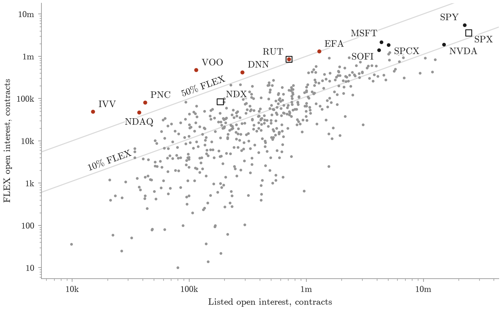
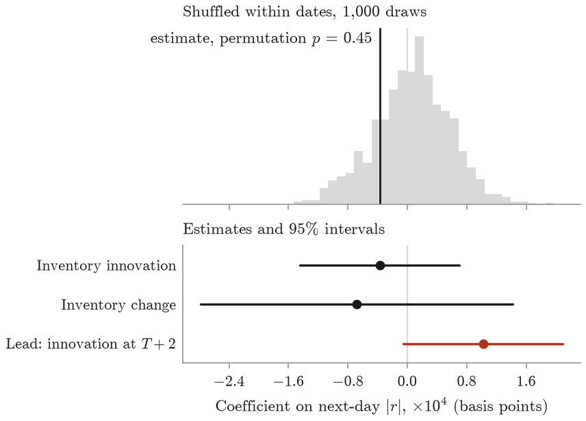

# The Hidden Options Market

**How much option convexity listed chains miss, and whether it moves prices.**

FLEX options are exchange options whose terms the counterparties choose. They are cleared
centrally, and they are absent from the listed option chains that most option research is
built on. They are not unobservable. The
Options Clearing Corporation publishes a free daily report of every cleared FLEX series —
root, strike, expiry, mark price and open interest — and this repository turns it into a
panel.

**In brief**

- **Size.** \$547bn of mark value on 22 October 2026. In a census of 680 underlyings, FLEX is at least a tenth of option open interest for 184.
- **Convexity.** Across the 71 followed underlyings with stored listed chains, over 48 settlements, FLEX is 18.0\% of the median one's option gamma when every contract is counted, which listed-only gamma figures leave out. Most of it is same-strike call/put pairs, which are forwards. With those netted it is 1.5\% (2.6\% if listed pairs are netted too). It stays large in SPY (12.0\% FLEX-netted) and NDX (15.0\%).
- **Does it move prices?** No effect found at daily resolution. In a test fixed in advance, netted FLEX dollar gamma does not predict next-day volatility (*t* -0.79, 353,972 underlying-days). The minimum detectable effect is 2.13bp per standard deviation, 1.1\% of mean \|*r*\|. The hedge a 1% move calls for is 5.86bp of a day's dollar volume in the median case. The bound is on an average slope across names, and the measure is unsigned, so books or names whose effects differ in sign could offset. An attempt to sign it in the 34 option-income programme names fails on the funds' own holdings: their written calls are listed, and they hold 4.5\% of the netted FLEX book there.
- **Pinning?** Not detected. On 2,643 expiries, over 326 dates, when only FLEX options expire, stocks without listed weekday expiries do not close nearer the largest FLEX strike (*t* -1.06). The rule leaves out the 32 names with listed weekday expiries, among them SPY, QQQ and the largest single names, where FLEX holds the most gamma; the books it covers are a median 3.5\% of a day's share volume. The minimum detectable pull is 0.078σ, but the same design finds no pinning at listed strikes on 34 monthly expirations either (net of a matched placebo added after the fact, *t* -1.64), so this is what the design can see, not proof of absence. Both tests are unsigned, so effects that differ in sign across books or names could offset.
- **Measurement.** Treating off-grid strikes as FLEX misses 53.5\% of FLEX series, and strike notional overstates delta exposure at least 2.34-fold.
- **Method.** Every number in the paper and in this README is generated from `results/*.json`, and CI checks that. The gamma measurement, the gamma test and the pinning test were each specified in a dated log entry before they were run.



*FLEX against listed open interest per underlying on 14 August 2026, log scales.
Coloured: FLEX is at least half of all open interest. Squares: index products, whose
listed side comes from the Cboe chain. The 200 census underlyings
with no FLEX open interest are not drawn.*

**For 25 of the 70 underlyings the collector follows
that are observed on every date (71 in all), at least a tenth of
option open interest is FLEX, outside the listed chain, on every date.** That holds on each of the 47 settlements captured from
14 August 2026 to 22 October 2026 (2 of the
49 in that span have no usable capture). For 3 of
those underlyings (EFA, MSFT and RUT) the share is at least 25% on every date,
and for RUT at least half, counting only series that expire after
each date; with the series expiring on a date included, its lowest share is
49.9\% (16 October 2026, a standard monthly expiry). The followed underlyings were chosen
mostly for the option-income programmes written on them: 22 of
43 programme names clear 10% on every date, against
3 of 27 controls. A one-date census of
680 underlyings with listed weekly options, on 14 August 2026,
gives the wider picture: the median FLEX share is 3.2\%,
184 underlyings are at 10% or more and 6 at half or
more (VOO, IVV, PNC, DNN, NDAQ and EFA).

OCC's series search and its FLEX report count the same FLEX open interest twice, and they
agree to the contract on 3,824 of 3,824
symbol-dates. Valued at the report's marks and at listed mid quotes (Cboe's theoretical
value where a quote is one-sided or crossed, 7.5\% of listed open interest),
FLEX holds 32.3\%–34.3\% of the followed underlyings' option
value, against 12.4\%–14.2\% of their open
interest. The gap is mostly deep in-the-money legs and call and put lines paired at the
same strike: on 22 October 2026, \$337bn of the
\$502bn of FLEX value on these underlyings is intrinsic and 71\% sits in
paired lines. One SPY put series, 16,052
contracts struck at 10,010.01 and paired with 16,052
call contracts at the same strike, is marked at \$14.7bn,
against \$19.7bn for every listed SPY option together.

## The FLEX market over 23 months

| | 2 December 2024 | 22 October 2026 |
|---|---:|---:|
| Open interest | 35.2m contracts | **67.9m contracts** |
| Mark value | \$298bn | **\$547bn** |

475 activity dates, 1,954 underlyings,
15.2m series-days. A one-break fit dates the turn in growth to
June 2025; averaged over a monthly expiry cycle, open interest stays in its
pre-break band of 33.4–35.5m contracts through the cycle ending
18 July 2025, and the latest cycle averages 71.8m, 2.1 times
the pre-break mean of 34.5m. The latest quarter added only +1.5\%.
The sawtooth in the chart is the expiry cycle: of the ten largest one-day falls in open
interest, all land on a monthly expiry or the activity date after it, where
only 9.7\% of day-to-day changes do. On the last date, 43,606
series across 1,030 underlyings: the ten largest underlyings hold
30\% of open interest, 50\% expires within sixty days,
22\% is more than a year from expiry (up from 13\% on the first
date), and 59\% is calls.

## How much gamma do listed chains leave out?

Gamma figures in public use are built from listed chains, and FLEX is not in them. Pricing
listed and FLEX series on one listed volatility surface over 48 settlements
(13 August 2026 to 22 October 2026, 71 underlyings) gives the following FLEX
shares of total dollar gamma:

| FLEX attribution | Median underlying | Pooled | SPX | SPY | NDX |
|---|---:|---:|---:|---:|---:|
| Gross | 18.0\% | 10.6\% | 8.2\% | 18.0\% | 20.3\% |
| Same-strike pairs netted, FLEX side | 1.5\% | 3.3\% | 2.1\% | 12.0\% | 15.0\% |
| Same-strike pairs netted, both sides | 2.6\% | 7.0\% | 4.7\% | 18.3\% | 20.5\% |

FLEX gamma is not deep in the money: 68\% of it sits within 5% of spot.
Gamma from the FLEX marks, where their inversion is validated (88.9\% of open
interest), is 1.02 times gamma from the listed surface. Specification:
[`docs/log/2026-11-07-hidden-gamma-spec.md`](docs/log/2026-11-07-hidden-gamma-spec.md).

## Does hidden inventory predict the visible market?

**On gamma.** The test regresses next-day absolute returns on pair-netted FLEX dollar gamma, scaled by
twenty-session dollar volume, with underlying and date fixed effects and two-way
clustering. It was fixed in advance in
[`docs/log/2026-11-08-gamma-predictive-spec.md`](docs/log/2026-11-08-gamma-predictive-spec.md).
The coefficient is -0.60bp per standard deviation (*t* -0.79, permutation *p*
0.092, Holm *p* 0.86) on 353,972 underlying-days. The minimum
detectable effect is 2.13bp, 1.1\% of mean |*r*|, which the rule fixed in
advance calls a bounded null. Netted gamma dated two activity dates later is negative
(*t* -4.93), and priced at the first date's spot, implied volatilities and
volume, so that only open interest moves, it is not (*t* -0.41): a large
move re-prices the book, carrying spot away from the strikes. The same re-pricing could
bias the test itself, so rows fixed in
[`docs/log/2026-11-08-gamma-timing-spec.md`](docs/log/2026-11-08-gamma-timing-spec.md)
before they were run price it on the day before (*t* -0.88) and add an
implied-volatility control (*t* 1.27). Neither finds an effect. A one-sided test in the
34 option-income programme names, fixed in
[`docs/log/2026-11-08-programme-gamma-spec.md`](docs/log/2026-11-08-programme-gamma-spec.md),
assumed the netted FLEX remainder there was the funds' written calls. It is inconclusive
(-7.29bp per standard deviation, *t* -0.82, wild cluster bootstrap *p*
0.22), and the assumption fails: in the daily holdings of 24 programme
funds, 0\% of the written calls are FLEX, and the funds hold
4.5\% of the netted FLEX open interest in those names.

**At hidden strikes.** Most listed options expire on Fridays, but FLEX options can expire on any weekday. A
Monday-to-Thursday FLEX expiry in a name that lists no option expiring that day is a date
on which only FLEX expires. On 2,643 such expiries (326 dates,
496 names), the test compares the close's distance to the largest expiring
FLEX strike with its distance to the mirror strike on the other side of the previous
close. It then subtracts the same comparison on the five sessions after expiry. The
result is -0.029σ (*t* -1.06, sign-flip *p* 0.29), with a minimum
detectable effect of 0.078σ. Large books do no better than small ones (*t*
0.66). Specification and its pre-outcome amendment:
[`docs/log/2026-11-08-pinning-spec.md`](docs/log/2026-11-08-pinning-spec.md).
As a positive control, fixed in
[`docs/log/2026-11-08-pinning-control-spec.md`](docs/log/2026-11-08-pinning-control-spec.md),
the same statistic at the nearest listed strike on 34 monthly expirations
(37,672 events) finds no pinning: -0.024σ (*t* -2.56). Most of
that is the design's own: with short-horizon reversal the statistic is not centred on zero.
A placebo added after the control was read, at strikes as far from the previous close on
each side, gives -0.016σ, and the control net of it is -0.007σ
(*t* -1.64). At FLEX strikes the same placebo is 0.001σ, and the
FLEX estimate net of it -0.031σ (*t* -1.14). The design does not detect
listed pinning in this panel, so the FLEX null reads as not detected, not absent.

**On contracts.** The original, cruder test regresses on open interest instead. A dealer on the other side of a FLEX trade hedges it in the listed market and carries the
residual convexity while the position lives. If that matters, inventory published
overnight for day *T* should say something about the underlying from day *T+1*, the first
day the report can be read.

It does not. The test covers 377,332 underlying-days across
1,407 underlyings and 468 activity dates, 9 December 2024 to
22 October 2026, with underlying and date fixed effects, errors clustered by underlying
and by date, and controls for trailing volatility over 5 and 22 sessions, the same day's
absolute return and log dollar volume. Each report meets the returns realised from the
day it became usable, and an inventory change across a date the underlying did not report
is dropped. Bars are fetched by the equity report's tickers, so index underlyings are left
out (a bare index symbol names another security, or none). Of the 1,547
equity names with at least 40 activity dates, 80 have
symbols the bar provider does not serve. OCC adjusted-deliverable roots, option classes
renamed with a digit after a corporate action changed their deliverable (`GME1`), account
for 33; share-class spellings such as `BRKB` for
1; other tickers, delisted and renamed names among them, for
46. Coefficients and MDE80 are multiplied by 10⁴, which for |r| is basis
points.

| predictor | outcome | β ×10⁴ | *t* | MDE80 ×10⁴ | clustered *p* | permutation *p* |
|---|---|---:|---:|---:|---:|---:|
| inventory innovation | next-day \|r\| | -0.41 | -0.74 | 1.54 | 0.46 | 0.42 |
| inventory change | next-day \|r\| | -0.67 | -0.63 | 3.01 | 0.53 | 0.47 |
| near-dated share change | next-day \|r\| | -1.52 | -0.39 | 10.89 | 0.69 | 0.69 |
| put share | next-day \|r\| | 0.56 | 0.22 | 7.19 | 0.83 | 0.61 |
| inventory innovation | next-day r² | 0.06 | 0.49 | 0.34 | 0.62 | 0.68 |
| **lead: innovation dated *after* the outcome** | next-day \|r\| | **0.93** | **1.73** | 1.51 | 0.084 | 0.085 |



The permutation *p* comes from 1,000 re-estimations with the predictor
shuffled across underlyings within each date, which treats underlyings as exchangeable
within a date. Among the genuine predictors the smallest permutation *p* is
0.42 and the smallest clustered *p* 0.46. The
lead row is inventory from two dates later. Its change includes contracts created
during the outcome's own session, so it is a test of reverse flow, volatility moving
later inventory, and not a placebo; its clustered *p* is 0.084. The
largest |*t*| among the genuine estimates, across every specification below, is
0.81.

Longer horizons say the same: mean |r| over the next 3, 5 and 10 sessions gives
*t* = -0.64, -0.66 and -0.31. Keeping only the
tenth of underlying-days with the largest inventory changes gives *t* = -0.81.
The close-to-close return includes an overnight move that partly precedes the report;
the open-to-close return of the day it becomes usable gives *t* = -0.80. The
minimum detectable effect at 80% power is 1.54 basis points per log point of
innovation, 0.8\% of the mean next-day |r| of 201 basis points.

Loading the panel from later start dates moves the estimates, not the conclusion:

| panel loaded from | underlying-days | inventory innovation | lead |
|---|---:|---:|---:|
| 2024-12-02 (table above) | 377,332 | -0.41 (*t* -0.74) | 0.93 (*t* 1.73) |
| 2025-07-23 | 264,825 | -0.23 (*t* -0.34) | 0.86 (*t* 1.23) |
| 2025-09-09 | 239,318 | 0.11 (*t* 0.15) | 0.81 (*t* 1.07) |

Not ruled out: strike-local effects, intraday responses, and effects on the listed option
surface rather than the underlying. Each needs data that cannot be collected
retrospectively for free. The first version of this test, on a shorter panel, is kept in
[`docs/log/`](docs/log/2026-08-19-predictive-result.md).

## Two measurement results that travel

**FLEX cannot be found by its strikes.** Listed strikes sit on a grid of whole dollars,
halves and quarters, so an off-grid strike looks like a FLEX tell. OCC's series search
marks every FLEX product with a leading digit, so the rule can be scored: over the
409,144 series with open interest in the 14 August 2026 census, it has
precision 0.707 and recall 0.465. FLEX is routinely struck *on* the
grid: 49.1\% of FLEX series sit on a whole dollar, the largest of them
`2PCG` at \$22.00 with 250,000 contracts. So
53.5\% of FLEX series, and 63.2\% of FLEX open interest,
are invisible to any strike-based test, and 29.3\% of what the rule flags is
listed. This project used the rule first; the superseded census is kept as it was in
[`docs/log/2026-08-18-flex-census.md`](docs/log/2026-08-18-flex-census.md).

**A cleared series is not a position.** Open interest is reported per series, and positions
span series. On an average date 78.7\% of FLEX open interest sits in groups of
series with near-equal counts at one expiry, against 26.5\% when the counts are dealt at
random. Scored against disclosed fund holdings, with the settings frozen first, that grouping
recalls 77.9\% of 36 held structures with precision 86.0\%. The test
rests on 18 funds of one family, where in the median held leg the fund holds
98.5\% of the open interest, and almost entirely on same-strike pairs; a match means consistent with a disclosed
holder, no more. On the 70.0\% of open interest with a validated delta, the median
underlying's strike notional, across 1,461 underlyings, is at least
2.34 times its delta exposure, whatever the signs of the legs. Counting every leg as long gives
3.60, a reading that is neither a floor nor a ceiling and that overstates the
ratio on the same-strike pairs funds disclose. On single
positions, recomputed from the report:

- a butterfly's strike notional is **49×** its maximum value;
- a four-leg SPY collar is counted about **2.8×** over;
- a call struck at \$1.87 is recorded as **\$7.0m** of strike notional
  when its exposure is **\$2.90bn**.

## Run it

Python 3.11+. Every input is free: no WRDS, no OptionMetrics, no vendor feed, no account.

```bash
uv venv && uv pip install -e '.[dev,paper]'
.venv/bin/pytest

# the OCC FLEX report, equity and index classes, for every date OCC still serves
.venv/bin/hidden-options backfill-flex --start 2024-12-02

# daily bars for the FLEX underlyings, far enough back for the trailing controls
.venv/bin/hidden-options refresh-bars

# results, figures, the generated paper numbers and this README, then the PDF
make all
```

Every downloaded report is checked against the per-class totals it carries and stored
under its own activity date, not the date it was fetched. OCC publishes overnight, so a
capture taken during a session returns the previous settlement; partitioning by fetch
date would enter one settlement twice as two suspiciously stable days. The numbers in this
README and the paper are rendered from `results/` by `make publish`, and `make check`
fails if any of them differs from its result file.

## Layout

```
src/hidden_options/collect/occ_flex.py        OCC FLEX report: fetch, parse, validate
src/hidden_options/collect/backfill.py        fetch the FLEX reports missing for a span of dates
src/hidden_options/measure/flex_panel.py      panel assembly and inventory measures
src/hidden_options/measure/hidden_share*.py   how much of each options market is FLEX
src/hidden_options/measure/identification*.py why a strike rule cannot find FLEX
src/hidden_options/measure/structures.py      leg grouping and valuation on the underlying
src/hidden_options/measure/holdings_truth.py  fund holdings as truth for the grouping, and its score
src/hidden_options/measure/positions*.py      series against positions across the market
src/hidden_options/predict/                   the predictive panel, regressions and permutation test
src/hidden_options/publish/                   results/ to the paper's numbers and tables and this README
src/hidden_options/collect/                   chains, holdings, bars and N-PORT collectors
scripts/                                      scheduling, one-off back-fills, reproduce.sh
docs/                                         how the data is collected; the template for this README
docs/log/                                     superseded work and corrections, dated, as written
archive/                                      the scripts behind the log's results
```

The earlier strike-heuristic census is rebuilt by `scripts/reproduce.sh`; the write-ups
of what was tried and what replaced it are indexed in [`docs/log/`](docs/log/README.md),
and the scripts that produced them in [`archive/`](archive/README.md). Raw snapshots
from the collectors are vendor-sourced and not redistributed here; the scheduled capture
is described in [`docs/OPERATIONS.md`](docs/OPERATIONS.md).

## License

MIT for the code.
