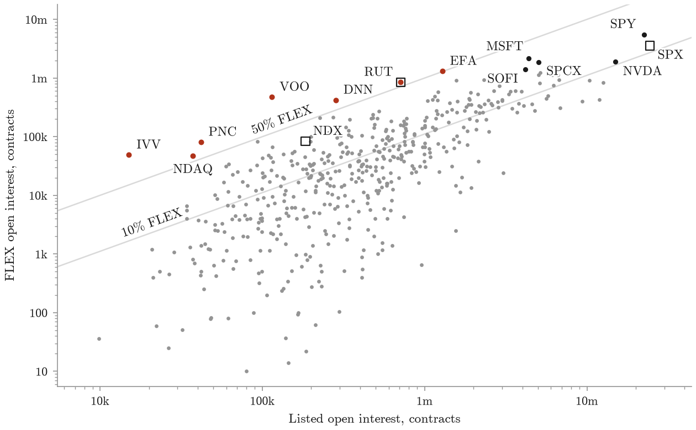
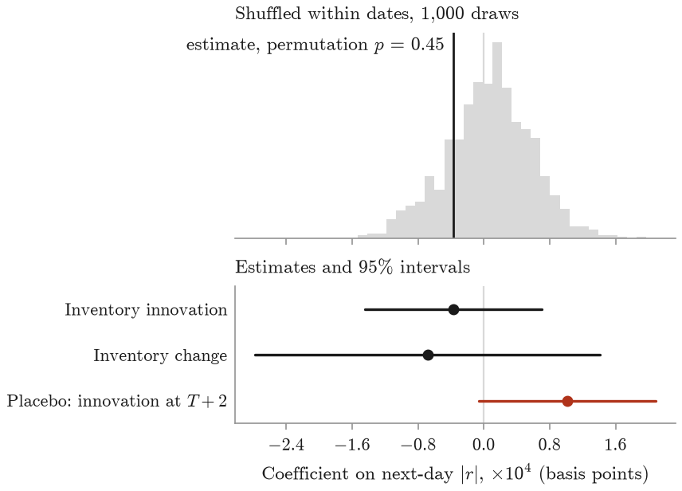

# The Hidden Options Market

**FLEX inventory in clearing data, and whether it predicts the visible market.**

FLEX options are negotiated bilaterally, cleared centrally, and absent from the listed
option chains that most option research is built on. They are not unobservable. The
Options Clearing Corporation publishes a free daily report of every cleared FLEX series —
root, strike, expiry, mark price and open interest — and this repository turns it into a
panel.



*FLEX against listed open interest per underlying on 14 August 2026, log scales.
Coloured: FLEX is at least half of all open interest. Squares: index products, whose
listed side comes from the Cboe chain. The 200 census underlyings
with no FLEX open interest are not drawn.*

**For 25 of the 70 underlyings the collector follows
that are observed on every date (71 in all), at least a tenth of
option open interest is FLEX, outside the listed chain, on every date.** That holds on each of the 47 settlements captured from
14 August 2026 to 22 October 2026 (2 of the
49 in that span have no usable capture). For 3 of
those underlyings (EFA, MSFT and RUT) the share is at least 25% on every date,
and for RUT at least half, counting only series that expire after
each date; with the series expiring on a date included, its lowest share is
49.9\% (16 October 2026, a standard monthly expiry). The followed underlyings were chosen
mostly for the option-income programmes written on them: 22 of
43 programme names clear 10% on every date, against
3 of 27 controls. A one-date census of
680 underlyings with listed weekly options, on 14 August 2026,
gives the wider picture: the median FLEX share is 3.2\%,
184 underlyings are at 10% or more and 6 at half or
more (VOO, IVV, PNC, DNN, NDAQ and EFA).

OCC's series search and its FLEX report count the same FLEX open interest twice, and they
agree to the contract on 3,824 of 3,824
symbol-dates. Valued at the report's marks and at listed mid quotes (Cboe's theoretical
value where a quote is one-sided or crossed, 7.5\% of listed open interest),
FLEX holds 32.3\%–34.3\% of the followed underlyings' option
value, against 12.4\%–14.2\% of their open
interest. The gap is mostly deep in-the-money legs and call and put lines paired at the
same strike: on 22 October 2026, \$337bn of the
\$502bn of FLEX value on these underlyings is intrinsic and 71\% sits in
paired lines. One SPY put series, 16,052
contracts struck at 10,010.01 and paired with 16,052
call contracts at the same strike, is marked at \$14.7bn,
against \$19.7bn for every listed SPY option together.

## The FLEX market over 23 months

| | 2 December 2024 | 22 October 2026 |
|---|---:|---:|
| Open interest | 35.2m contracts | **67.9m contracts** |
| Mark value | \$298bn | **\$547bn** |

475 activity dates, 1,954 underlyings,
15.2m series-days. A one-break fit dates the turn in growth to
June 2025; averaged over a monthly expiry cycle, open interest stays in its
pre-break band of 33.4–35.5m contracts through the cycle ending
18 July 2025, and the latest cycle averages 71.8m, 2.1 times
the pre-break mean of 34.5m. The latest quarter added only +1.5\%.
The sawtooth in the chart is the expiry cycle: of the ten largest one-day falls in open
interest, all land on a monthly expiry or the activity date after it, where
only 9.7\% of day-to-day changes do. On the last date, 43,606
series across 1,030 underlyings: the ten largest underlyings hold
30\% of open interest, 50\% expires within sixty days,
22\% is more than a year from expiry (up from 13\% on the first
date), and 59\% is calls.

## Does hidden inventory predict the visible market?

A dealer on the other side of a FLEX trade hedges it in the listed market and carries the
residual convexity while the position lives. If that matters, inventory published
overnight for day *T* should say something about the underlying from day *T+1*, the first
day the report can be read.

It does not. The test covers 377,332 underlying-days across
1,407 underlyings and 468 activity dates, 9 December 2024 to
22 October 2026, with underlying and date fixed effects, errors clustered by underlying
and by date, and controls for trailing volatility over 5 and 22 sessions, the same day's
absolute return and log dollar volume. Each report meets the returns realised from the
day it became usable, and an inventory change across a date the underlying did not report
is dropped. Bars are fetched by the equity report's tickers, so index underlyings are left
out (a bare index symbol names another security, or none). Of the 1,547
equity names with at least 40 activity dates, 80 have
symbols the bar provider does not serve. OCC adjusted-deliverable roots, option classes
renamed with a digit after a corporate action changed their deliverable (`GME1`), account
for 33; share-class spellings such as `BRKB` for
1; other tickers, delisted and renamed names among them, for
46. Coefficients and MDE80 are multiplied by 10⁴, which for |r| is basis
points.

| predictor | outcome | β ×10⁴ | *t* | MDE80 ×10⁴ | clustered *p* | permutation *p* |
|---|---|---:|---:|---:|---:|---:|
| inventory innovation | next-day \|r\| | -0.37 | -0.68 | 1.53 | 0.50 | 0.45 |
| inventory change | next-day \|r\| | -0.68 | -0.64 | 2.99 | 0.52 | 0.46 |
| near-dated share change | next-day \|r\| | -1.67 | -0.44 | 10.74 | 0.66 | 0.67 |
| put share | next-day \|r\| | 0.56 | 0.22 | 7.19 | 0.83 | 0.61 |
| inventory innovation | next-day r² | 0.06 | 0.47 | 0.34 | 0.64 | 0.71 |
| **placebo: innovation dated *after* the outcome** | next-day \|r\| | **1.02** | **1.86** | 1.53 | 0.063 | 0.057 |



The permutation *p* comes from 1,000 re-estimations with the predictor
shuffled across underlyings within each date, which treats underlyings as exchangeable
within a date. Among the genuine predictors the smallest permutation *p* is
0.45 and the smallest clustered *p* 0.50. The
placebo is inventory from two dates later, dated after the outcome, so it cannot predict
it; its clustered *p* is 0.063, and whatever association it shows can
only run from volatility to later inventory, or through something common to both. The
largest |*t*| among the genuine estimates, across every specification below, is
0.87.

Longer horizons say the same: mean |r| over the next 3, 5 and 10 sessions gives
*t* = -0.55, -0.57 and -0.18. Keeping only the
tenth of underlying-days with the largest inventory changes gives *t* = -0.87.
The close-to-close return includes an overnight move that partly precedes the report;
the open-to-close return of the day it becomes usable gives *t* = -0.77. The
minimum detectable effect at 80% power is 1.53 basis points per log point of
innovation, 0.8\% of the mean next-day |r| of 201 basis points.

Loading the panel from later start dates moves the estimates, not the conclusion:

| panel loaded from | underlying-days | inventory innovation | placebo |
|---|---:|---:|---:|
| 2024-12-02 (table above) | 377,332 | -0.37 (*t* -0.68) | 1.02 (*t* 1.86) |
| 2025-07-23 | 264,825 | -0.19 (*t* -0.27) | 0.98 (*t* 1.38) |
| 2025-09-09 | 239,318 | 0.16 (*t* 0.22) | 0.93 (*t* 1.23) |

Not ruled out: strike-local effects, intraday responses, and effects on the listed option
surface rather than the underlying. Each needs data that cannot be collected
retrospectively for free. The first version of this test, on a shorter panel, is kept in
[`docs/log/`](docs/log/2026-08-19-predictive-result.md).

## Two measurement results that travel

**FLEX cannot be found by its strikes.** Listed strikes sit on a grid, so an off-grid
strike looks like a FLEX tell. Scored against the OCC report over 486,895 cleared series,
that rule has precision 0.67 and recall 0.34. FLEX is routinely struck *on* the grid —
`1AAON` at \$99.00 is FLEX — so two thirds of it is invisible to any strike-based test,
and a third of what the rule flags is not FLEX at all. This project used the rule first;
the superseded census is kept as it was in
[`docs/log/2026-08-18-flex-census.md`](docs/log/2026-08-18-flex-census.md).

**A cleared series is not a position.** Open interest is reported per series, and
positions span series. Conflating them produced errors in both directions that do not
cancel:

- a butterfly counted leg by leg is credited with **49×** its maximum attainable value;
- a four-leg SPY collar is counted about **3×** over;
- a synthetic long call struck at \$1.87 against a \$765 spot is recorded as **\$7m** of
  strike notional when its exposure is **\$2.9bn**.

## Run it

Python 3.11+. Every input is free: no WRDS, no OptionMetrics, no vendor feed, no account.

```bash
uv venv && uv pip install -e '.[dev,paper]'
.venv/bin/pytest

# the OCC FLEX report, equity and index classes, for every date OCC still serves
.venv/bin/hidden-options backfill-flex --start 2024-12-02

# daily bars for the FLEX underlyings, far enough back for the trailing controls
.venv/bin/hidden-options refresh-bars

# results, figures, the generated paper numbers and this README, then the PDF
make all
```

Every downloaded report is checked against the per-class totals it carries and stored
under its own activity date, not the date it was fetched. OCC publishes overnight, so a
capture taken during a session returns the previous settlement; partitioning by fetch
date would enter one settlement twice as two suspiciously stable days. The numbers in this
README and the paper are rendered from `results/` by `make publish`, and `make check`
fails if any of them differs from its result file.

## Layout

```
src/hidden_options/collect/occ_flex.py      OCC FLEX report: fetch, parse, validate
src/hidden_options/collect/backfill.py      fetch the FLEX reports missing for a span of dates
src/hidden_options/measure/flex_panel.py    panel assembly and inventory measures
src/hidden_options/measure/hidden_share*.py how much of each options market is FLEX
src/hidden_options/measure/structures.py    leg grouping and valuation on the underlying
src/hidden_options/predict/                 the predictive panel, regressions and permutation test
src/hidden_options/publish/                 results/ to the paper's numbers and tables and this README
src/hidden_options/collect/                 chains, holdings, bars and N-PORT collectors
scripts/                                    scheduling, one-off back-fills, reproduce.sh
docs/                                       how the data is collected; the template for this README
docs/log/                                   superseded work and corrections, dated, as written
archive/                                    the scripts behind the log's results
```

The earlier strike-heuristic census is rebuilt by `scripts/reproduce.sh`; the write-ups
of what was tried and what replaced it are indexed in [`docs/log/`](docs/log/README.md),
and the scripts that produced them in [`archive/`](archive/README.md). Raw snapshots
from the collectors are vendor-sourced and not redistributed here; the scheduled capture
is described in [`docs/OPERATIONS.md`](docs/OPERATIONS.md).

## License

MIT for the code.
